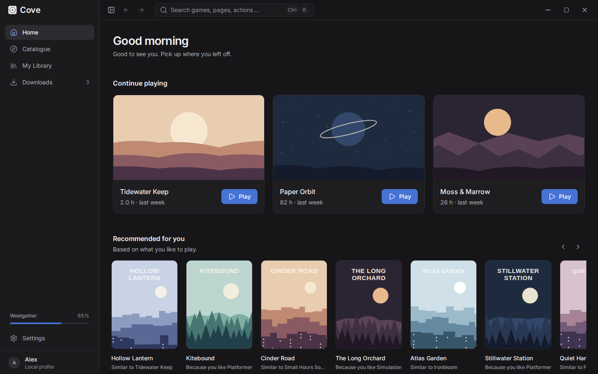
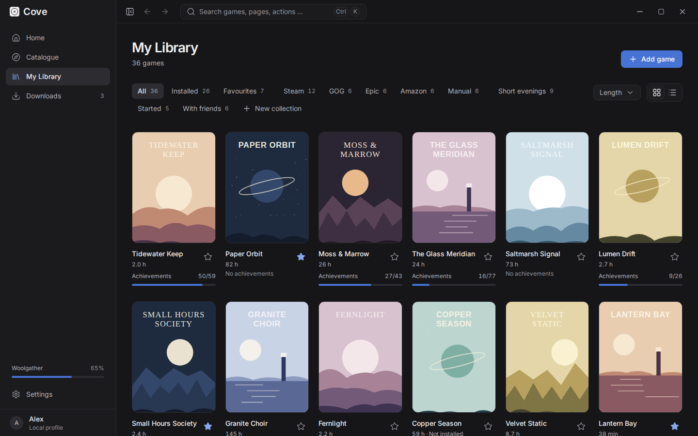
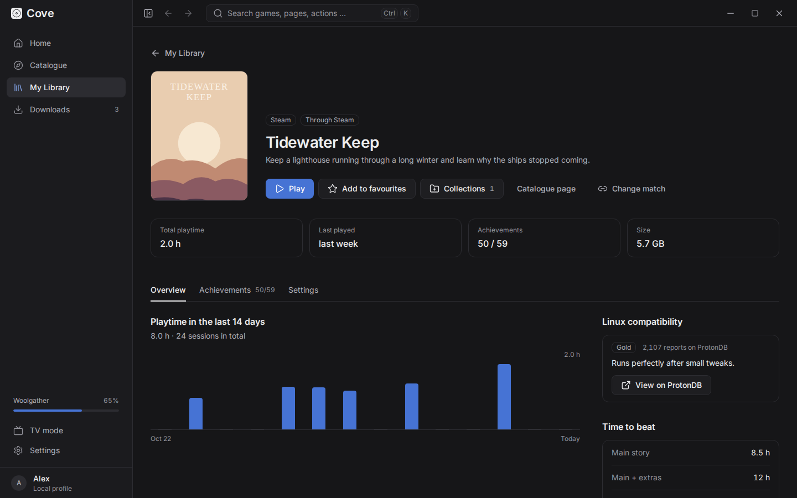
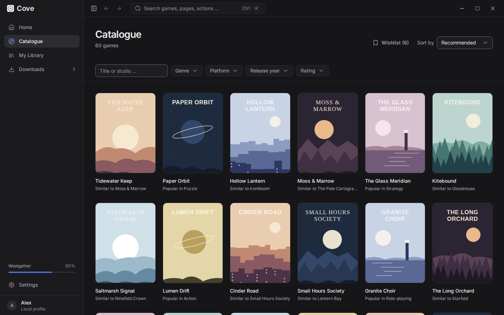
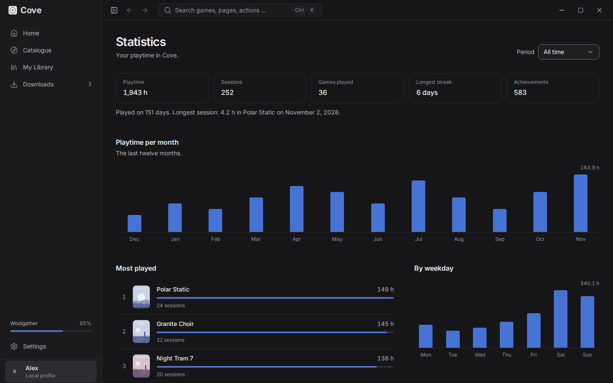
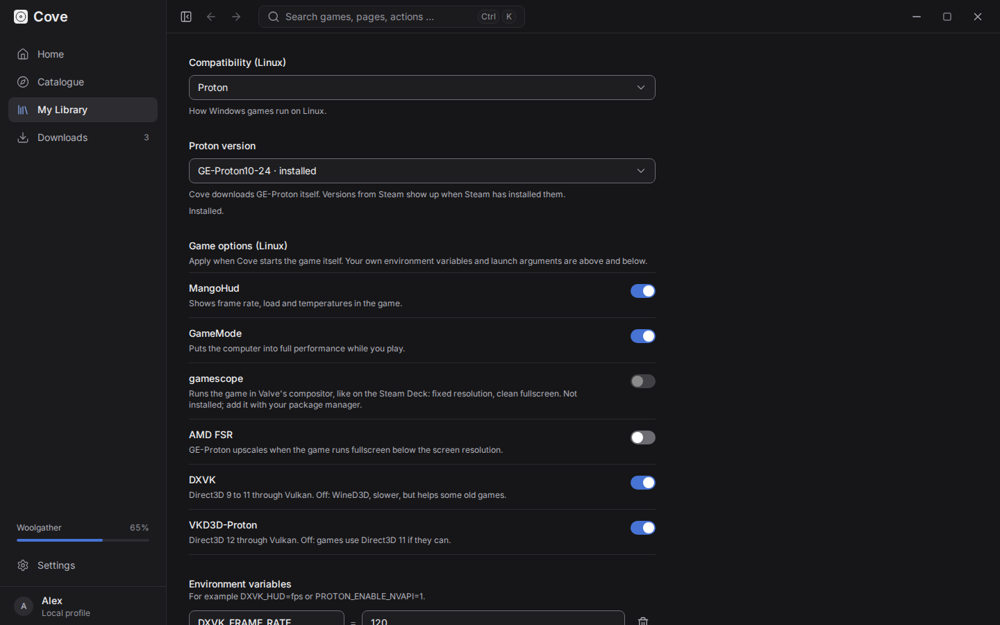
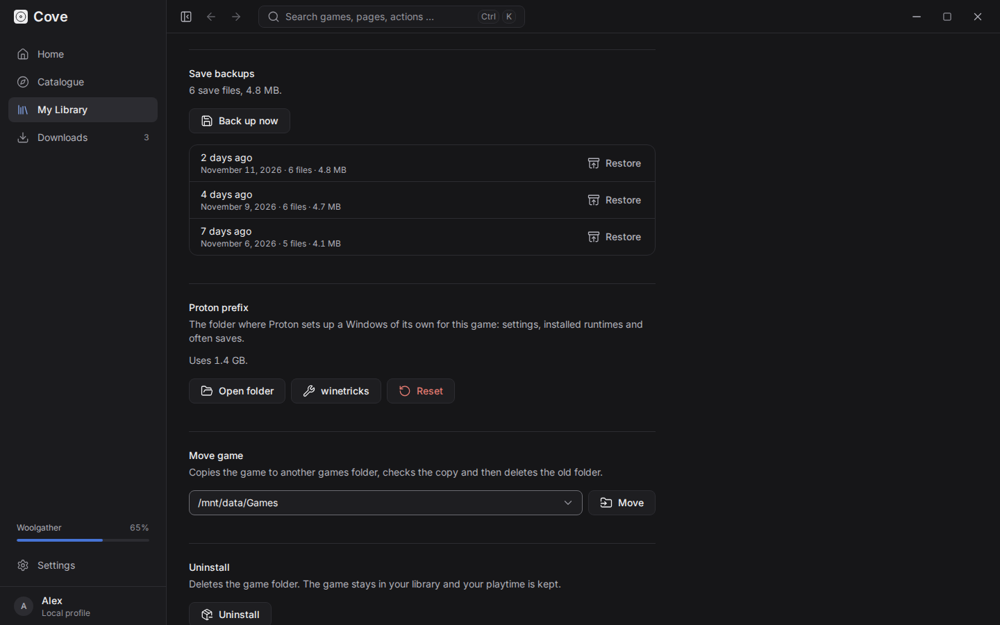
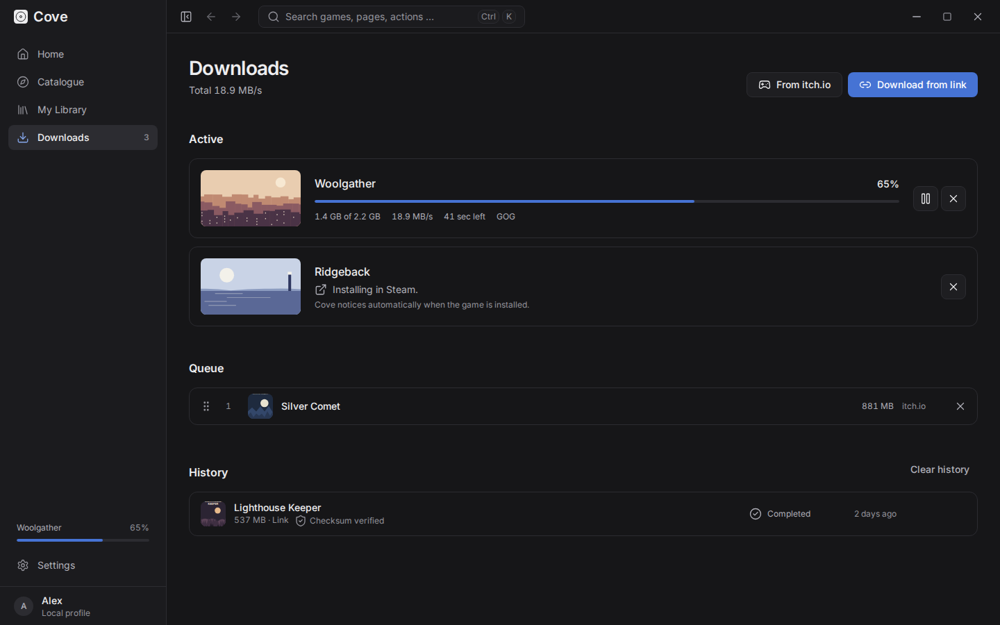
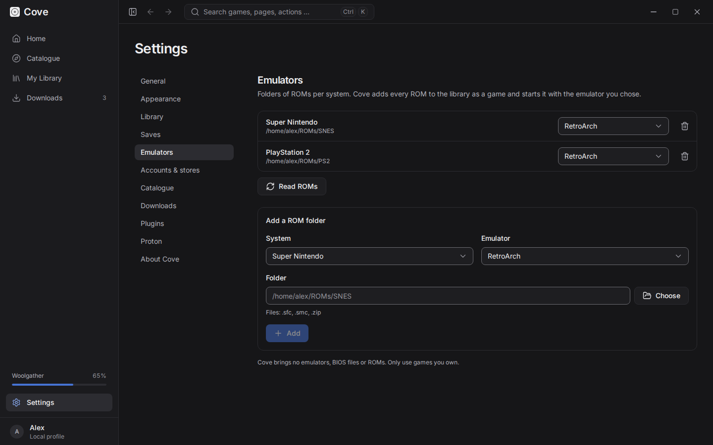
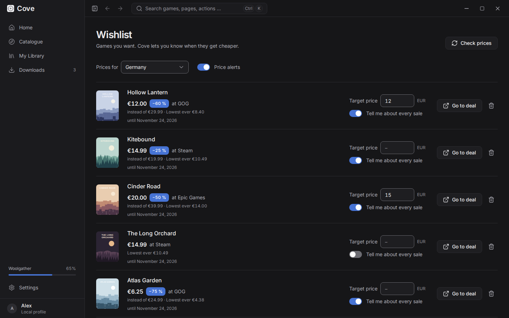

# Cove

**A calm, universal game launcher for Linux, Windows and macOS.**

Cove brings your games from Steam, GOG, Epic, Amazon, itch.io, emulators and your own folders
together in one tidy library. It installs GOG, Epic and Amazon games without their launchers, runs Windows games on
Linux with Proton, backs up your saves and keeps track of playtime and achievements.
No ads, no social feed, no account of its own.

[Download](https://github.com/bjoernhar10/Cove-Launcher/releases/latest) ·
[Features](#features) ·
[Build from source](#build-from-source) ·
[Plugins](docs/plugins.md)



| | |
|---|---|
|  |  |
|  |  |
|  |  |
|  |  |
|  | |

<sub>The screenshots show invented demo games with drawn artwork.</sub>

## Features

### One library

- **Every store in one place:** sign in to Steam, GOG, Epic and Amazon (Prime Gaming) on the
  store's own login page and your games, playtime and achievements are imported. Add your itch.io key to download your
  purchases. Games already installed through Steam, Heroic, Legendary or GOG Galaxy are found
  without any login.
- **Your own games and emulators:** add any game folder, or a ROM folder per system (NES to
  PlayStation 2, Dreamcast, PSP …). Every ROM becomes a game in your library and starts with
  RetroArch, a standalone emulator (Dolphin, PCSX2, DuckStation, PPSSPP, mGBA, melonDS, Flycast)
  or your own program. Cove brings no emulators, BIOS files or ROMs.
- **Tidy:** grid or list, groups for installed games, favourites and each store, your own
  collections ("With friends", "Started" …), a length filter and a command palette (`Ctrl+K`).
  Stays smooth with thousands of games.
- **Playtime and achievements:** playtime follows the whole process tree, the game page shows the
  last 14 days. Achievements come from the stores, plus Cove's own and those of plugins.
- **Statistics:** click your profile at the bottom left for your playtime per month and weekday,
  most played games, genres, stores, streaks and longest sessions, for all time or one year.

### Installing and playing

- **GOG, Epic and Amazon without their launchers:** Cove downloads, installs, updates and starts
  GOG, Epic and Amazon games itself (Windows builds through Proton on Linux), with your choice of
  DLCs. Updates only download what changed. Games with
  anti-cheat or a third-party launcher are left to the Epic Launcher, and Cove says so.
- **Steam stays Steam:** Steam games install and start through Steam. If Steam isn't running, Cove
  starts it silently first, so no Steam window pops up.
- **Downloads from legal sources:** your itch.io purchases (with soundtracks and other extras)
  and direct links for DRM-free games, mods and patches. Parallel chunks, pause and resume, a
  bandwidth limit, checksum checks and unpacking. Before each install Cove shows the sizes, the
  target folder and the free space; installed games can be moved between drives.

### Linux gaming

- **Proton without Steam:** GE-Proton (downloaded and kept up to date by Cove) or any Proton Steam
  installed, per game or as the default. Proton runs inside the Steam Linux Runtime through
  umu-launcher, with its per-game fixes, just like in Steam.
- **Game options per game:** MangoHud, GameMode, gamescope (with game resolution and fullscreen),
  AMD FSR, and DXVK / VKD3D-Proton on or off, next to your own launch arguments and environment
  variables.
- **Prefix tools:** see each game's Proton prefix size, open it, reset it or run winetricks.
- **Linux compatibility at a glance:** every game page shows its ProtonDB rating.

### Your saves

- **Save backups for every game:** after each session Cove backs up the game's saves into a folder
  you choose, for example one that Syncthing or Nextcloud syncs. Where a game keeps its saves comes
  from the open [Ludusavi manifest](https://github.com/mtkennerly/ludusavi-manifest) (over 20,000
  games), also inside Proton prefixes. Restore any backup from the game page.
- **Cloud saves** of the GOG and Epic games Cove installed are synced before and after playing,
  compatible with GOG Galaxy and the Epic Launcher.

### Discovering

- **Catalogue** with search and filters (genre, platform, year, rating), powered by IGDB through
  Cove's own proxy, so you need no API keys. Works offline from a local cache.
- **Recommendations** computed on your own computer, each with a short reason.
- **Time to beat:** main story, main + extras and 100 % on game pages.
- **Wishlist with price alerts:** put catalogue games on your wishlist, see the best current price
  across 30+ shops and the lowest price ever, set a target price and get a notification when it is
  reached or a sale starts. Prices by [IsThereAnyDeal](https://isthereanydeal.com/).

### And also

- **Private by design:** Cove never sees your store passwords; tokens live only in your system's
  keyring. Recommendations are computed locally.
- **Calm design:** a dark, quiet interface with five muted accent colours, fully usable with the
  keyboard, WCAG 2.1 AA contrast. English and German.
- **Plugins** in plain JavaScript, isolated in a Web Worker with browser-extension-style
  permissions. Guide: [docs/plugins.md](docs/plugins.md).
- **Updates itself** through the signed Tauri updater (Windows, macOS and AppImage; `.deb` and
  `.rpm` installs are updated by the package manager).

## Install

Download the newest version from the [releases page](https://github.com/bjoernhar10/Cove-Launcher/releases/latest):

| System | Download |
|---|---|
| Linux x86_64 | `.AppImage` (updates itself), `.deb` (`amd64`), `.rpm` (`x86_64`) |
| Linux ARM64 | `.AppImage`, `.deb` (`arm64`), `.rpm` (`aarch64`) |
| Linux (Flatpak) | `Cove-x86_64.flatpak`, `Cove-aarch64.flatpak` (`flatpak install Cove-x86_64.flatpak`); Flathub is planned |
| Windows x64 | `-setup.exe` or `.msi` |
| macOS Apple Silicon | `_aarch64.dmg` |
| macOS Intel | `_x64.dmg` |

On Linux the `.deb` and `.rpm` packages also install MangoHud, GameMode and gamescope where the
distribution has them (as recommended packages, so a missing one never blocks the install). With
the AppImage, install them with your package manager if you want them, e.g.
`sudo dnf install mangohud gamemode gamescope`.

The macOS builds are not notarized yet: if macOS refuses to open Cove, right-click it in
Applications and choose **Open**.

## Build from source

### Requirements

- Node.js 22+
- Rust (stable) with `clippy` and `rustfmt`
- Linux: the Tauri system packages. Fedora:
  `sudo dnf install webkit2gtk4.1-devel gtk3-devel libsoup3-devel`;
  Debian/Ubuntu:
  `sudo apt install libwebkit2gtk-4.1-dev libgtk-3-dev libsoup-3.0-dev librsvg2-dev`
  ([other distributions](https://v2.tauri.app/start/prerequisites/))
- [.NET SDK 9](https://dotnet.microsoft.com/download) for the store connectors
  (Native AOT also needs `clang` and `zlib-devel`; without them a self-contained build is made)
- [uv](https://docs.astral.sh/uv/) for the recommender (Python 3.12 is installed by uv)

### Run in development

```sh
npm install
npm run build:sidecar -w @cove/desktop   # once: store connectors (C#) and recommender (Python)
npm run dev                               # Tauri + Vite with hot reload
```

The app also starts without the sidecars; store sign-in and personal recommendations are then off.
App data (SQLite database, Proton prefixes, plugins) lives in the app data folder, on Linux
`~/.local/share/app.cove.desktop/`.

### Build packages

```sh
npm run tauri:build -w @cove/desktop                                  # all bundles for this system
npm run tauri:build -w @cove/desktop -- --bundles appimage,deb,rpm    # Linux
npm run tauri:build -w @cove/desktop -- --bundles msi,nsis            # Windows
```

Bundles end up in `apps/desktop/src-tauri/target/release/bundle/`.

## Tests

```sh
npm run check                                   # ESLint + TypeScript, Vitest, plugin tests
npm run test:e2e -w @cove/desktop               # Playwright: main flows, 2500-game library, WCAG AA (axe)
(cd apps/desktop/src-tauri && cargo clippy --all-targets -- -D warnings && cargo test)
(cd services/connectors && dotnet test && dotnet format --verify-no-changes)
(cd services/recommender && uv run ruff check . && uv run mypy && uv run pytest)
```

The end-to-end tests drive the real UI in Chromium against an in-memory stand-in for the Rust
core (`apps/desktop/src/test/e2e.ts`); the core itself is covered by its own IPC tests.
Before the first run: `npx playwright install chromium` in `apps/desktop`.

GitHub Actions runs all of this on every push and pull request
([ci.yml](.github/workflows/ci.yml)) and builds the packages for every system, each on its own
runner ([release.yml](.github/workflows/release.yml)).

README screenshots come from `COVE_SCREENSHOTS=1 npx playwright test screenshots` in
`apps/desktop` (invented games from `e2e/demoGames.ts`, English UI).

## Releasing

1. Raise the version in `apps/desktop/src-tauri/tauri.conf.json` (and `Cargo.toml`, `package.json`).
2. Push a tag: `git tag v0.6.0 && git push origin v0.6.0`.
3. The Build workflow creates a **draft** release with all packages, update signatures and
   `latest.json`. Check it and publish it; installed copies of Cove then offer the update.

Update packages are signed. The public key is in `tauri.conf.json`; the private key must be stored
as the repository secrets `TAURI_SIGNING_PRIVATE_KEY` (and `TAURI_SIGNING_PRIVATE_KEY_PASSWORD`).
Never commit it.

## Architecture

| Area | Technology | Folder |
|---|---|---|
| Core | Rust, Tauri 2, SQLite (sqlx) | `apps/desktop/src-tauri` |
| UI | React 19, TypeScript, Vite, Tailwind CSS v4, Zustand, TanStack Query/Virtual | `apps/desktop/src` |
| Store connectors & achievements | C# .NET 9 (Native AOT), JSON-RPC over stdio | `services/connectors` |
| Recommendations | Python 3.12 (uv, scikit-learn), JSON-RPC over stdio | `services/recommender` |
| Plugins | JavaScript (ES modules) | `plugins` |
| Catalogue proxy (IGDB, Steam Web API) | TypeScript, Cloudflare Workers, Hono | `services/catalog-proxy` |
| Shared types & JSON schemas | TypeScript | `packages/shared` |

Details in [docs/architecture.md](docs/architecture.md). Design and code rules live in [CLAUDE.md](CLAUDE.md).
To run your own catalogue proxy, see [docs/proxy.md](docs/proxy.md). Flatpak and Flathub: [docs/flatpak.md](docs/flatpak.md).

Game data provided by [IGDB.com](https://www.igdb.com).

## License

[MIT](LICENSE)
