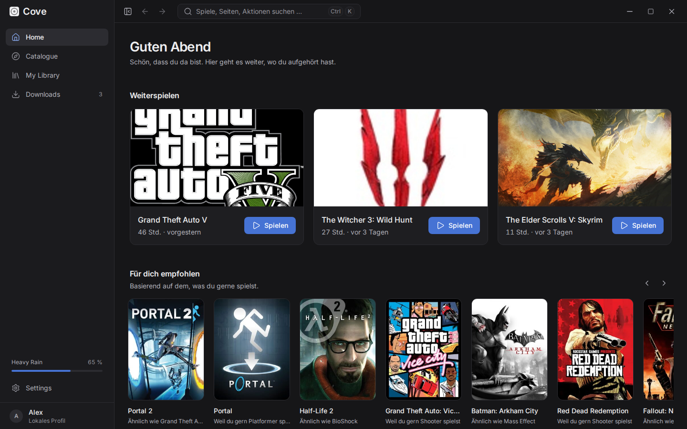
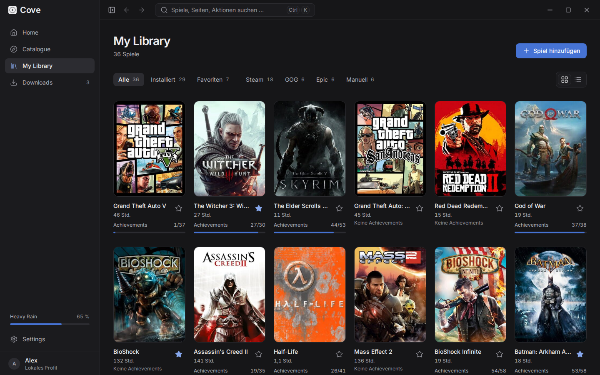
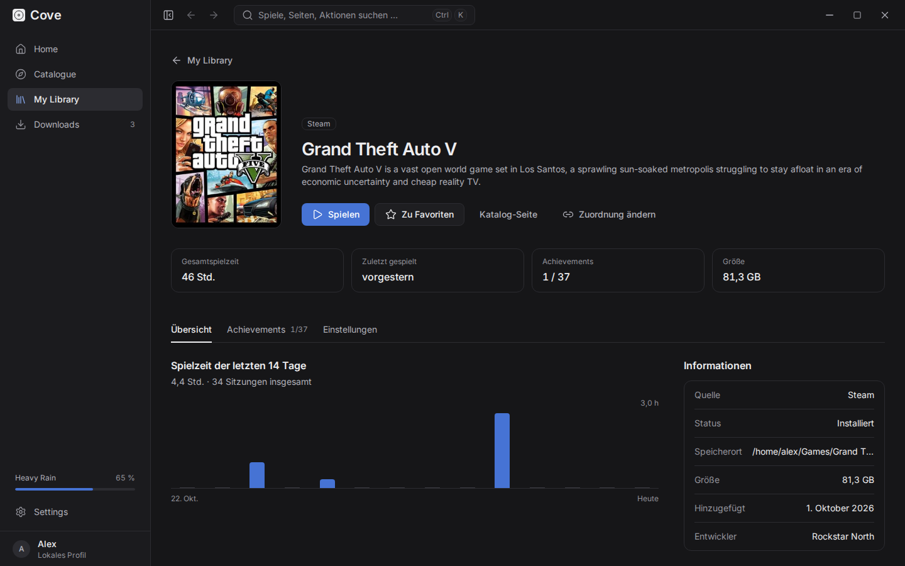
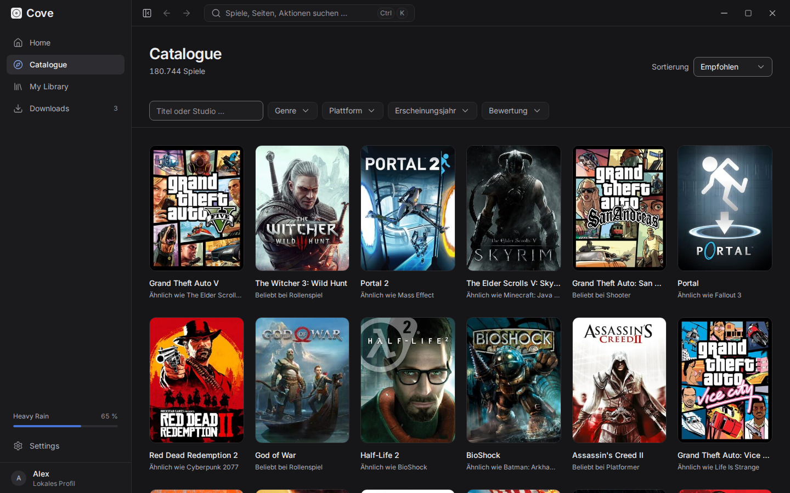
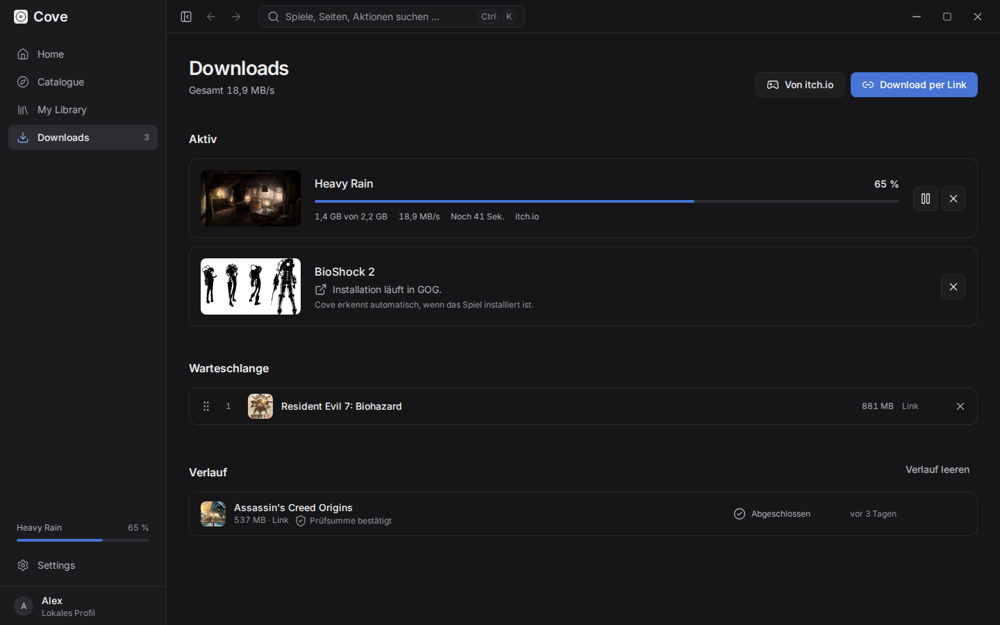

# Cove

A calm, universal desktop game launcher for **Linux and Windows** (macOS later).
Cove brings your games from Steam, GOG, Epic, itch.io and your own folders together in **one**
tidy library, launches them (on Linux optionally through Proton or Wine) and keeps track of
playtime and achievements. No ads, no social feed, no accounts of its own.



| | |
|---|---|
|  |  |
|  |  |

> Status: early development (0.1). Everything below works; expect rough edges.
> The screenshots show the real app with game data from IGDB and an example profile.

## Features

- **One library for everything:** grid or list view, groups for installed games, favourites and
  each store. Stays smooth with thousands of games (virtualised lists, lazy images).
- **Store accounts:** sign in to Steam, GOG and Epic in the store's own login page. Cove never
  sees your password; tokens stay in the system keyring. Owned games, playtime and achievements
  are imported. Games installed locally (Steam, Heroic, Legendary, GOG Galaxy) are found without
  any login.
- **Launching and playtime:** native, through Proton or Wine (Linux), or through the store client,
  with custom arguments and environment variables. Playtime follows the whole process tree;
  the game page shows the last 14 days.
- **Catalogue** with search and filters (genre, platform, year, rating), powered by IGDB through
  Cove's own proxy, so you need no API keys. Works offline from a local cache.
- **Recommendations** computed on your machine (hybrid content-based recommender in Python),
  each with a short reason. If the recommender is unavailable, Cove falls back to a simple ranking.
- **Downloads** from legal sources only: direct links for DRM-free games, mods and patches, and
  your itch.io purchases through the official API. Parallel chunks, resume after restart, pause,
  bandwidth limit, SHA-256 check, unpacking (zip, 7z, tar, tar.gz) and automatic library entry.
  Store games are installed by their own client (Steam, Heroic, Galaxy, Epic), never by Cove.
- **Achievements** from the stores plus Cove's own (and plugin) achievements.
- **Plugins** in plain JavaScript, isolated in a Web Worker with browser-extension-style
  permissions. Guide: [docs/plugins.md](docs/plugins.md).
- **Calm design:** dark interface, five muted accent colours, command palette (`Ctrl+K`),
  fully usable with the keyboard, WCAG 2.1 AA contrast.
- **German and English:** the whole app, including error messages and recommendation reasons,
  follows the language chosen in Settings (new installs start in the system language).
- **Updates** through the signed Tauri updater (Windows and AppImage; `.deb`/`.rpm` installs are
  updated by the package manager).

## Install

Pre-built packages will be on the [releases page](https://github.com/bjoernhar10/Cove-Launcher/releases):

| System | Package |
|---|---|
| Linux | `.AppImage` (updates itself), `.deb`, `.rpm` |
| Windows | `.msi` or the `-setup.exe` (NSIS) installer |

Until the first release, every push to `main` builds all packages; download them from the
artifacts of the latest [Build workflow run](https://github.com/bjoernhar10/Cove-Launcher/actions/workflows/release.yml).

## Build from source

### Requirements

- Node.js 22+
- Rust (stable) with `clippy` and `rustfmt`
- Linux: the Tauri system packages. Fedora:
  `sudo dnf install webkit2gtk4.1-devel gtk3-devel libsoup3-devel`;
  Debian/Ubuntu:
  `sudo apt install libwebkit2gtk-4.1-dev libgtk-3-dev libsoup-3.0-dev librsvg2-dev`
  ([other distributions](https://v2.tauri.app/start/prerequisites/))
- [.NET SDK 9](https://dotnet.microsoft.com/download) for the store connectors
  (Native AOT also needs `clang` and `zlib-devel`; without them a self-contained build is made)
- [uv](https://docs.astral.sh/uv/) for the recommender (Python 3.12 is installed by uv)

### Run in development

```sh
npm install
npm run build:sidecar -w @cove/desktop   # once: store connectors (C#) and recommender (Python)
npm run dev                               # Tauri + Vite with hot reload
```

The app also starts without the sidecars; store sign-in and personal recommendations are then off.
App data (SQLite database, Proton prefixes, plugins) lives in the app data folder, on Linux
`~/.local/share/app.cove.desktop/`.

### Build packages

```sh
npm run tauri:build -w @cove/desktop                                  # all bundles for this system
npm run tauri:build -w @cove/desktop -- --bundles appimage,deb,rpm    # Linux
npm run tauri:build -w @cove/desktop -- --bundles msi,nsis            # Windows
```

Bundles end up in `apps/desktop/src-tauri/target/release/bundle/`.

## Tests

```sh
npm run check                                   # ESLint + TypeScript, Vitest, plugin tests
npm run test:e2e -w @cove/desktop               # Playwright: main flows, 2500-game library, WCAG AA (axe)
(cd apps/desktop/src-tauri && cargo clippy --all-targets -- -D warnings && cargo test)
(cd services/connectors && dotnet test && dotnet format --verify-no-changes)
(cd services/recommender && uv run ruff check . && uv run mypy && uv run pytest)
```

The end-to-end tests drive the real UI in Chromium against an in-memory stand-in for the Rust
core (`apps/desktop/src/test/e2e.ts`); the core itself is covered by its own IPC tests.
Before the first run: `npx playwright install chromium` in `apps/desktop`.

GitHub Actions runs all of this on every push and pull request
([ci.yml](.github/workflows/ci.yml)) and builds the Linux and Windows packages
([release.yml](.github/workflows/release.yml)).

## Releasing

1. Raise the version in `apps/desktop/src-tauri/tauri.conf.json` (and `Cargo.toml`, `package.json`).
2. Push a tag: `git tag v0.2.0 && git push origin v0.2.0`.
3. The Build workflow creates a **draft** release with all packages, update signatures and
   `latest.json`. Check it and publish it; installed copies of Cove then offer the update.

Update packages are signed. The public key is in `tauri.conf.json`; the private key must be stored
as the repository secrets `TAURI_SIGNING_PRIVATE_KEY` (and `TAURI_SIGNING_PRIVATE_KEY_PASSWORD`).
Never commit it.

## Architecture

| Area | Technology | Folder |
|---|---|---|
| Core | Rust, Tauri 2, SQLite (sqlx) | `apps/desktop/src-tauri` |
| UI | React 19, TypeScript, Vite, Tailwind CSS v4, Zustand, TanStack Query/Virtual | `apps/desktop/src` |
| Store connectors & achievements | C# .NET 9 (Native AOT), JSON-RPC over stdio | `services/connectors` |
| Recommendations | Python 3.12 (uv, scikit-learn), JSON-RPC over stdio | `services/recommender` |
| Plugins | JavaScript (ES modules) | `plugins` |
| Catalogue proxy (IGDB, Steam Web API) | TypeScript, Cloudflare Workers, Hono | `services/catalog-proxy` |
| Shared types & JSON schemas | TypeScript | `packages/shared` |

Details in [docs/architecture.md](docs/architecture.md). Design and code rules live in [CLAUDE.md](CLAUDE.md).
To run your own catalogue proxy, see [docs/proxy.md](docs/proxy.md).

Game data provided by [IGDB.com](https://www.igdb.com).

## License

[MIT](LICENSE)
